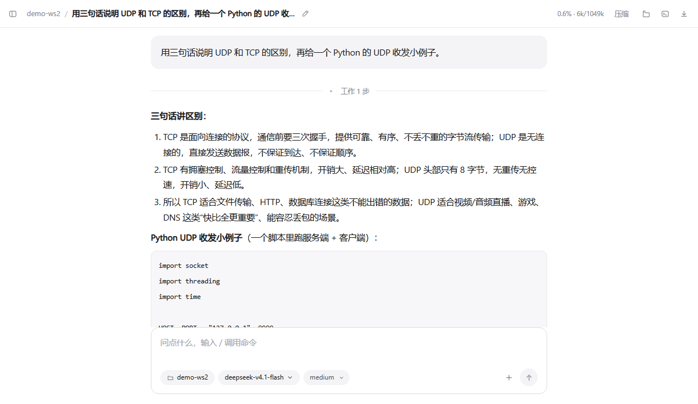
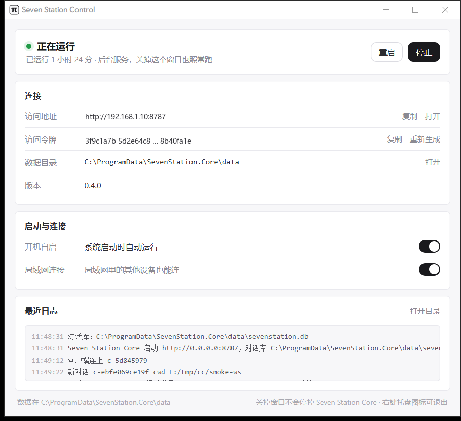

<div align="center">
  

  # Seven Station
</div>

Pi 的客户端。把 Pi 放到一台常驻的机器上跑，别的设备连过来只管说话和看结果，会话、工作区、子进程都在那一台机器上。

三个名字分工固定：**Seven Station Core** 是那台常驻的服务，**Seven Station Control** 是管它的窗口，
**Seven Station** 是装在其它设备上的客户端。桌面窗口和手机浏览器连的是同一个 Seven Station Core，看到的也是同一份会话。

## 截图

<p align="center">
  
  
</p>

## 特性

- **一处会话多处看**：同一个会话被桌面和手机同时打开时共用一个 Pi 子进程，正文、思考、工具调用广播给所有连接。
- **完整的过程可见**：流式正文与思考块、工具调用卡片（状态、参数摘要、耗时，展开能看输出）、每轮的工作步数。
- **按工作目录管会话**：列出本机所有 Pi 会话，按工作目录与日期分组，点开就续聊。改名与删除只动 Seven Station Core 自己的记录，不碰 Pi 的会话文件。
- **工作区里干活**：`@` 补全文件、`/` 调命令、只读浏览工作区、常驻终端、连正文一起搜。
- **模型与上下文**：切模型、切思考等级、看上下文用量、手动压缩，参数改完所有设备一起生效。
- **装成服务**：Seven Station Core 注册为 Windows 服务，开机自启。Seven Station Control 负责开停、看日志、改监听地址。

## 快速开始

需要 Windows x64。两个包都要管理员权限，Seven Station Core 那台机器上还要已经装好 Pi（默认在 `~/.pi/agent`）。

**装包**：从 [Releases](https://github.com/huaxianyan/SevenStation/releases) 下一个版本的两个包，先装 Seven Station Core，再装客户端。
Seven Station Core 注册服务并开始监听，客户端第一次打开会让你填地址和访问令牌，令牌在 Seven Station Core 那台机器的
`%ProgramData%\SevenStation.Core\token.txt`，也可以直接在 Seven Station Control 里复制。

**从源码跑**：Seven Station Core 要 .NET 10 SDK，客户端与控制台要 Rust 工具链与 WebView2 运行时。

```powershell
pwsh -File scripts/dev-run.ps1    # 构建并起 Seven Station Core 与客户端，开 9222 调试端口
```

只想起停 Seven Station Core、不做构建：

```powershell
pwsh -File scripts/start-center.ps1    # 起
pwsh -File scripts/stop-center.ps1     # 停
```

开发时的令牌在 `%LOCALAPPDATA%\SevenStation\token.txt`，客户端会自动读取。要把会话记录挪开、不污染日常用的那份：

```powershell
pwsh -File scripts/dev-run.ps1 -SessionDir E:\tmp\sevenstation-sessions
```

## 使用

**跨设备访问**：Seven Station Core 默认只听 `127.0.0.1`。要让局域网里的设备连进来，在 Seven Station Control 里打开「局域网连接」，
按提示放行防火墙（只放行本地子网），然后把窗口里显示的地址和令牌填进客户端，或在手机浏览器打开
`http://<地址>:<端口>/?token=<令牌>`。这一步等于把 Pi 的 shell 对局域网开放，只在可信网段做。

**改配置**：配置在 `%ProgramData%\SevenStation.Core\settings.json`，改完要在 `services.msc` 里重启 `SevenStationCore`，
或者用 Seven Station Control 的「重启」。最近工作区、快捷键、配色这些在设置页里改，存在对话库里，跟着会话一起走。

**输入区**：`@` 补全文件，`/` 列命令，图片可以粘也可以拖。代码块右上角能复制，头部能把整段对话导出成 Markdown。
快捷键 `Ctrl+K` 新建对话、`Ctrl+B` 侧栏、`Ctrl+J` 终端、`Ctrl+E` 文件、`Ctrl+F` 搜索。

## 设计与实现

| 项 | 选择 | 原因 |
| --- | --- | --- |
| Seven Station Core | ASP.NET Core（.NET 10）+ WebSocket | 一条长连接管状态与流式事件，HTTP 只留静态页与健康检查 |
| 对话库 | SQLite | 单用户单机，库就一个文件，备份是复制 |
| 客户端 | Tauri 2 + WebView2 | 壳只负责窗口与系统集成，界面和手机浏览器共用同一份前端 |
| Seven Station Control | Tauri 2 + 服务与防火墙命令 | 要管理员权限的操作集中在一个窗口里，一次 UAC 做完 |
| 前端 | 原生 HTML/CSS/JS | 没有构建步骤，改完刷新就是新的 |

```text
src/SevenStation.Core/        Seven Station Core：对话库、Pi 子进程、WebSocket、托管前端
src/SevenStation.Core/Storage/ 对话库（SQLite）
src/SevenStation.Core/wwwroot/ 前端，桌面与手机共用
src/SevenStation.Desktop/     客户端：Tauri 壳，只加载 Seven Station Core 的地址
src/SevenStation.Control/     Seven Station Control：服务启停、日志、监听与令牌
src/Shared/                   两边共用的文件日志
design/                       图标与安装画面的生成脚本、界面原型
installer/                    WiX 工程与安装包素材
```

## 文档

- [设计与决策](docs/ARCHITECTURE-seven-station.md)：目标形态、host / agent / client 三层分工。
- [决定记录](docs/DECISIONS.md)：命名、目录、界面与发布这些定下来的事，连同理由。
- [进度](docs/STATUS.md)：当前主线与每条验收记录。
- [交接记录](docs/handoff/)：按天的实现细节与踩过的坑。
- [打包与发布](RELEASE.md)：版本号在哪、怎么出包、怎么发 Release。
- [发布说明](docs/release-notes/)：每个版本一个文件。

## 调试

前端没有构建步骤，`dev-run.ps1` 会开 9222 调试端口：

```powershell
node scripts/ui-smoke.mjs --cwd E:\tmp\sevenstation-smoke-ws    # 新建会话并真调一次模型
```

整屏截图抓不到 WebView2 的画面，要看界面用 CDP 的 `Page.captureScreenshot`。日志在 `%LOCALAPPDATA%\SevenStation\logs\`，
Seven Station Core 的在 `%ProgramData%\SevenStation.Core\logs\`。

## 限制

- 只放 Windows x64 包，Seven Station Core 以后会出 Linux 版。
- 局域网只到防火墙放行，没有 TLS。跨公网要自己套一层。
- 手机端是同一个页面，窄屏布局还没专门调。
- 图片只作为附件随消息发送，还没让模型直接读图。

## 许可证

本项目采用 GNU 通用公共许可证第 3 版（GPLv3）发布，许可证全文见 [LICENSE](LICENSE)。
